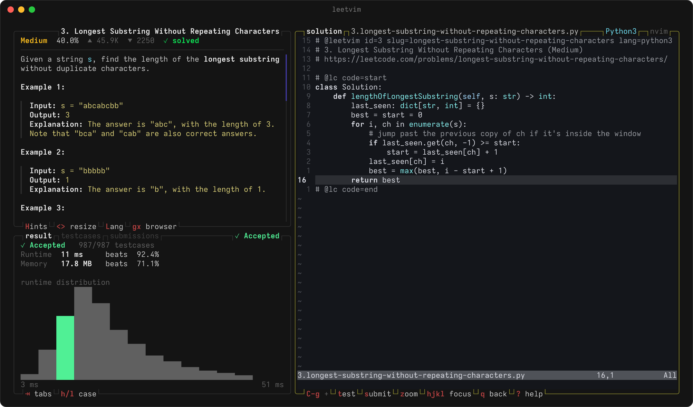
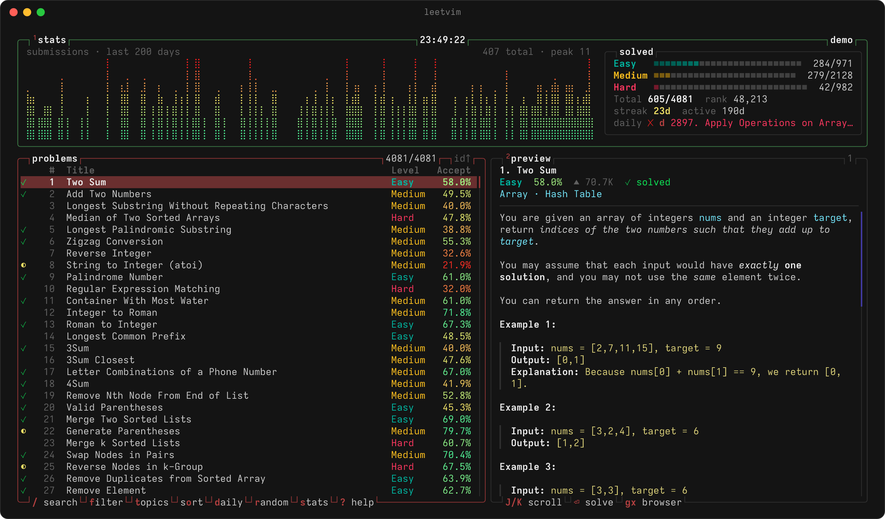
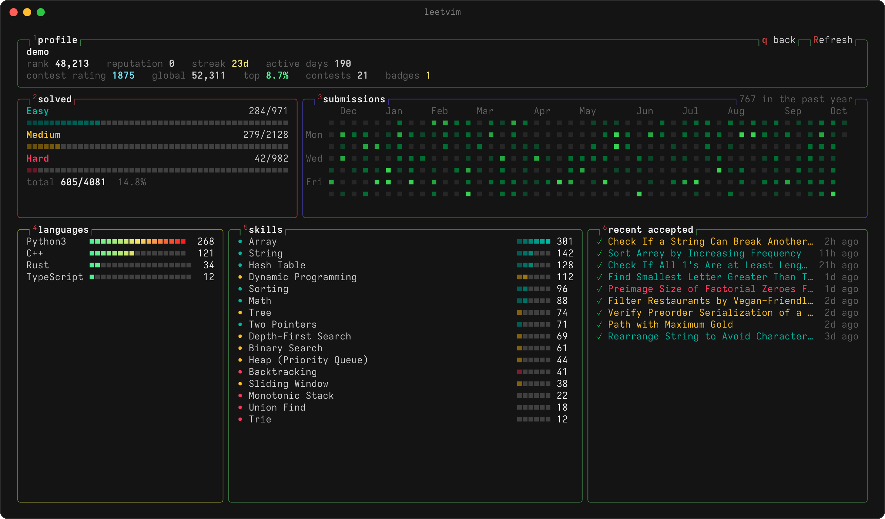

<h1 align="center">leetvim</h1>

<p align="center"><b>LeetCode in your terminal, solved in your own vim.</b></p>

<p align="center">
  <a href="https://github.com/phongndo/leetvim/actions/workflows/ci.yml"></a>
</p>

<p align="center">
  
</p>

leetvim is a [btop](https://github.com/aristocratos/btop)-style TUI for LeetCode. Browse the
whole problem set, read problems as rich text, and solve them in a split where the right pane is
your real `nvim` or `vim`, with your config, plugins and LSP, running inside leetvim. Run the
testcases and submit without leaving the editor. Nothing is installed into your editor.

- **Your editor, embedded**: leetvim hosts vim in a pseudo-terminal and saves your buffers
  before every run or submit.
- **The whole problem set**: fuzzy search, filters for difficulty, status and topic, sorting,
  the daily question and random picks, all with vim motions.
- **Judge results in place**: per-case output against expected, compile and runtime errors,
  runtime and memory percentiles with the distribution, past submissions and custom testcases.
- **One-command sign-in**: `leetvim login` uses the session from the browser you already use
  and renews it when it expires.
- **Your progress**: activity graph, solved meters, streak, heatmap, languages, skills and
  contest rating.
- **Themes**: btop's palette, `tokyo-night`, `gruvbox`, `catppuccin`, `nord` and `light`.

<p align="center">
  
  
</p>

## Install

With [Nix](https://nixos.org) (flakes enabled), try it:

```sh
nix run github:phongndo/leetvim
```

or put `leetvim` on your `PATH`:

```sh
nix profile install github:phongndo/leetvim
```

leetvim runs `nvim`, `vim` or `vi` from your `PATH`; set `editor` in the config to use
something else.

<details>
<summary>Building without Nix</summary>

The Nix build is the tested one. Elsewhere you need a C++23 compiler and standard library,
CMake 3.28+, Ninja, pkg-config, and the development packages for libcurl, nlohmann_json 3.11+,
CLI11, SQLite 3, OpenSSL (libcrypto) and libvterm; doctest too unless you pass
`-DLEETVIM_BUILD_TESTS=OFF`.

```sh
cmake -B build -G Ninja -DCMAKE_BUILD_TYPE=Release
cmake --build build
./build/leetvim
```

</details>

## Quick start

```sh
leetvim login
leetvim daily
```

`login` links your LeetCode account from your browser and `daily` opens today's question;
`leetvim` on its own opens the dashboard. In the solve view the editor has focus, so leetvim's own keys follow a prefix, `Ctrl-g` by
default (like tmux): `C-g t` runs the testcases, `C-g s` submits, `C-g q` goes back to the
list. Press `?` anywhere for every key.

## Your account

LeetCode has no API tokens or OAuth for third-party apps; everything, including running and
submitting, works with the website's session cookie. So leetvim uses the session your browser
already has:

1. Sign in at leetcode.com in your browser as usual.
2. Run `leetvim login`, or press `l` on the welcome screen the first time the TUI starts
   (`:login` later).

leetvim looks for the session in Chrome, Helium, Arc, Brave, Edge, Vivaldi, Opera, Chromium,
Firefox, Zen, LibreWolf, Safari and Orion, asks LeetCode which sessions are signed in, and
links that account (asking which one if there are several). Chromium-based browsers encrypt
cookies with a key in the macOS Keychain, so macOS asks once to unlock it: choose
**Always Allow**. Reading Safari's cookies needs Full Disk Access for your terminal.

When LeetCode rejects an expired session (at startup, or before a run or submit), leetvim takes
a fresh one from the same browser profile and retries, so as long as you stay signed in to
leetcode.com in that browser you don't log in to leetvim again.

Other ways in:

- `leetvim login --browser helium` searches only one browser.
- `leetvim login --paste` (or `:login paste`) takes a `Cookie` header copied from DevTools.
- The `LEETCODE_SESSION` and `LEETCODE_CSRF_TOKEN` environment variables override the saved
  session.

`leetvim logout` deletes the saved session.

### What leetvim keeps track of

LeetCode stays the source of truth for your progress; leetvim reads it instead of keeping a
second copy:

| Data | Where it lives | When it updates |
| --- | --- | --- |
| Solved / attempted per problem | LeetCode, cached in `$XDG_CACHE_HOME/leetvim` | every launch (one request) and after each submit |
| Submissions, runtime and memory percentiles | LeetCode | the results panel's submissions tab |
| Stats, streak, calendar, contest rating, skills | LeetCode | launch, accepted submissions, `R` |
| Daily question and whether you've done it | LeetCode | launch, accepted submissions |
| Your solutions | `~/leetcode/<id>.<slug>.<ext>` (the `workspace` setting) | you edit them; leetvim never overwrites one |
| Custom testcases | `<workspace>/.leetvim/testcases/<slug>.txt` | the testcases tab |
| Session | `$XDG_DATA_HOME/leetvim/credentials` (mode 0600) | login and automatic renewal |
| Settings | `$XDG_CONFIG_HOME/leetvim/config.toml` | `leetvim config --edit`, the theme and language pickers |

Problems you solve on the website show up the next time leetvim starts. The workspace is a
plain directory of solution files, so it works well as a git repository.

## Keys

**Problem list**

| Key | Action |
| --- | --- |
| `j` `k` `gg` `G` `C-d` `C-u` | move |
| `Enter` / `l` | solve the selected problem |
| `/` | fuzzy search by title or id |
| `f` / `t` | filters / topics |
| `o` / `O` | cycle the sort / reverse it |
| `d` / `r` | daily question / random pick |
| `J` `K` | scroll the preview |
| `1` `2` | toggle the stats / preview boxes |
| `s` | stats dashboard |
| `y` / `gx` | copy the link / open in the browser |
| `L` / `T` | default language / theme |
| `R` | re-sync problems and stats |

**Solve view**, with the editor focused:

| Key | Action |
| --- | --- |
| `C-g t` | run the testcases on LeetCode |
| `C-g s` | submit |
| `C-g h` / `C-g j` / `C-g l` | focus the description / results / editor |
| `C-g r` | toggle the results panel |
| `C-g c` | testcases |
| `C-g z` | zoom the editor |
| `C-g q` | back to the list (the editor keeps running) |
| `C-g C-g` | send `C-g` to vim |

In the description, `j` `k` `C-d` `C-u` `gg` `G` scroll, `H` reveals hints, `<` `>` resize the
split and `L` switches the solution language in the same vim. In the results panel, `h` `l` or
`1`–`9` pick a testcase, `Tab` cycles result / testcases / submissions, `e` edits the custom
testcases and `x` resets them to the examples.

**Commands** (`:`): `:daily`, `:random`, `:open <id|slug|title>` (or just `:42`),
`:lang <slug>`, `:theme <name>`, `:set <key>=<value>`, `:login`, `:logout`, `:sync`, `:stats`,
`:run`, `:submit`, `:q`.

## Command line

```text
leetvim                          the TUI
leetvim daily [--print]          open (or print) today's question
leetvim open <problem>           open a problem by id, slug or title
leetvim show <problem> [-m]      print the description (-m: as Markdown)
leetvim list [-d hard] [-s todo] [-t dynamic-programming] [-q query] [-n 20]
leetvim test <file>              run a solution file's testcases (exit status 1 on failure)
leetvim submit <file>            submit a solution file
leetvim stats [username]         print profile statistics
leetvim login [-b browser] [-p] [--cookie header]
leetvim logout | sync
leetvim config [--init | --edit]
leetvim -c <file> ...            use another config file
```

`test` and `submit` work from any editor, e.g. `:!leetvim test %` in vim.

## Solutions and testcases

Solutions live in the workspace (`~/leetcode` by default) as `<id>.<slug>.<ext>`:

```python
# @leetvim id=1 slug=two-sum lang=python3
# 1. Two Sum (Easy)
# https://leetcode.com/problems/two-sum/

# @lc code=start
class Solution:
    def twoSum(self, nums: list[int], target: int) -> list[int]:
        ...
# @lc code=end
```

Only the code between the markers is sent to LeetCode (leetcode.nvim's `@leet start` /
`@leet end` markers work too), so includes and helpers for your LSP can live outside them. The
`inject_before` / `inject_after` config tables add such text to new files. Custom testcases are
stored one input line per parameter.

## Configuration

`leetvim config --init` writes a commented `$XDG_CONFIG_HOME/leetvim/config.toml` listing every
option: `lang`, `editor`, `workspace`, `prefix`, `save_before_run`, `theme`,
`theme_background`, `rounded_corners`, `truecolor`, `mouse`, `split`, `show_paid`, `username`,
`refresh_hours`, `[inject_before]` and `[inject_after]`. Picking a theme or default language
in the TUI updates the file in place, keeping your comments.

The problem list and question details are cached and refreshed every `refresh_hours` (24 by
default), or on `R` / `leetvim sync`. Set `LEETVIM_LOG=/path/to/file` to log HTTP requests and
notifications.

## Development

The flake provides the toolchain: the latest clang from nixpkgs (with clangd, clang-tidy and
clang-format), CMake, Ninja, treefmt, nixfmt and gersemi.

```sh
nix develop
cmake -B build -G Ninja -DCMAKE_BUILD_TYPE=Debug -DLEETVIM_SANITIZE=ON
cmake --build build && ctest --test-dir build
```

`LEETVIM_SANITIZE` takes `address,undefined` (or `ON`) or `thread`, and any sanitizer report
fails the test. `LEETVIM_LIVE_TESTS=1 ./build/test_leetcode` also queries the real public API,
and `nix fmt` formats everything (clang-format, nixfmt, gersemi).

### Checks

`nix flake check` runs the same checks as CI, which runs each one as its own job on Linux
(x86_64 and arm64) and macOS:

| Check | What it catches |
| --- | --- |
| `leetvim` | build errors and warnings (as errors), failing unit tests |
| `sanitize` | memory errors, leaks and undefined behaviour in the tests (AddressSanitizer, UBSan) |
| `tsan` | data races (ThreadSanitizer) |
| `gcc` | non-portable code, by building with GCC and libstdc++ (Linux) |
| `clang-tidy` | bug-prone patterns and static-analyzer findings in `src/`, `tests/` and `fuzz/` |
| `fuzz` | crashes on the fuzz seeds and past findings, plus a fixed-seed burst of mutations |
| `format`, `actionlint` | unformatted files, mistakes in the CI workflows |

### Fuzzing

`fuzz/` has libFuzzer targets for everything that reads input leetvim doesn't control:
LeetCode's HTML and API responses, browser cookie stores, terminal input, the config file,
solution files, and text measuring. Besides crashes and sanitizer reports, they check
properties such as laid-out lines fitting their width and solution files handing back exactly
the code between the markers.

```sh
nix run '.#fuzz' -- html 300
nix run '.#fuzz' -- all 120
```

The corpus collects in `fuzz-corpus/` and failing inputs in `fuzz-crashes/`. Once a finding is
fixed, copy its input into `fuzz/seeds/<target>/` so the `fuzz` check replays it. CI fuzzes
every target for two minutes on each push and for 25 minutes nightly, carrying the corpus
between runs; the nightly run also checks that LeetCode's API still matches what leetvim
parses.

### Layout

`src/` is split into layered libraries, each with tests under `tests/<module>/`:

| Module | Role |
| --- | --- |
| `util` | UTF-8 and display width, strings, fuzzy matching, XDG paths, logging |
| `content` | LeetCode HTML to a document model, then terminal lines or Markdown |
| `leetcode` | API client (GraphQL and judge endpoints over libcurl), browser sessions, credentials, cache |
| `tui` | raw terminal, input parsing, diffing renderer, btop-style widgets, themes, and the pty + libvterm pane that hosts the editor |
| `core` | config, languages, workspace files, editor resolution, account linking |
| `app` | the event loop, views, overlays and the command line |

Only leetcode.com is supported (not leetcode.cn). leetvim is not affiliated with LeetCode.
